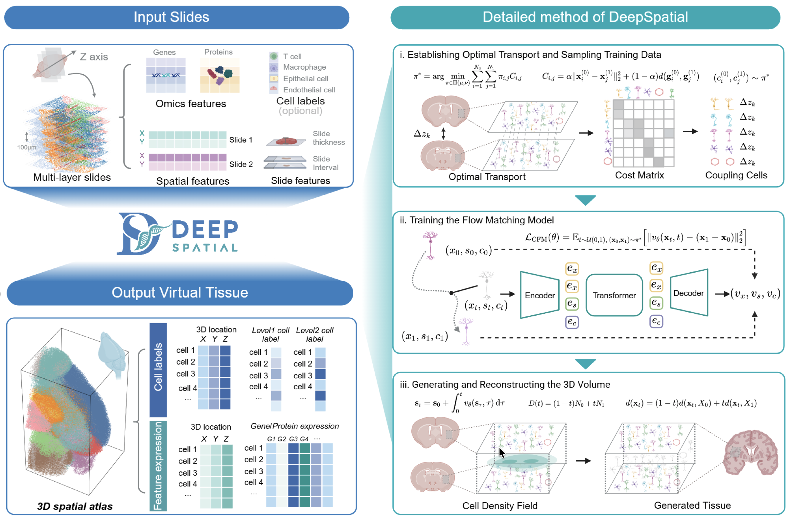
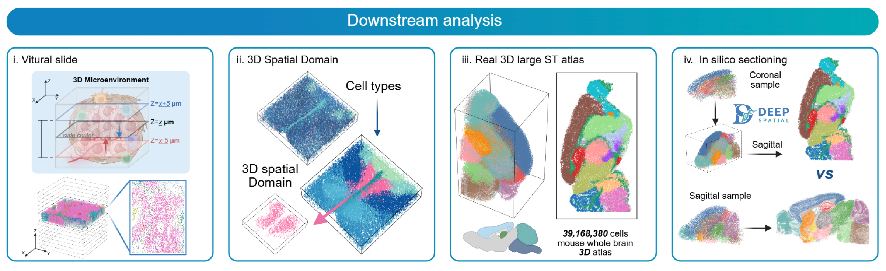

# Documentation

[](https://pypi.org/project/deepspatial/)
[](https://doi.org/10.64898/2026.04.28.721395)
[](https://opensource.org/licenses/MIT)


## Introduction

**DeepSpatial** is a deep learning framework designed to reconstruct continuous 3D tissue models from disjointed 2D spatial transcriptomics slices.


DeepSpatial uses UOT-coupled endpoint cells and continuous flow matching over spatial coordinates, gene expression, and relaxed one-hot cell-type states to reconstruct a unified 3D coordinate space.

See the [implementation-aligned method](method.md) for the exact training and
generation equations and the reported benchmark configuration.


---

## Features

* **Real 3D Reconstruction**: Synthesize missing biological landscapes between pre-aligned 2D slices to recover a high-fidelity, seamless 3D tissue volume.
* **Multi-Omics Support**: Broad support for spatial transcriptomics and proteomics, allowing for comprehensive multi-modal characterization of tissue architecture in 3D.
* **Seamless Ecosystem Integration**: Built upon `AnnData` and fully compatible with the `Scanpy` ecosystem for streamlined downstream 3D analysis.
* **GPU Accelerated**: High-performance PyTorch implementation optimized for efficient 3D manifold recovery of large-scale spatial datasets.
* **Explicit Bidirectional Generation**: Forward and reverse-time ODE trajectories are sampled with depth-dependent direction probabilities.
* **Density-aware Sampling**: Virtual depths reflect the cell-count gradient between adjacent observed slices.

---

## Quickstart

First install the DeepSpatial package via `pip`:

```bash
pip install deepspatial
```

The following example demonstrates a minimal workflow for high-fidelity 3D volumetric reconstruction:

```python
import scanpy as sc
import deepspatial as ds

# Load a sequence of pre-aligned 2D AnnData slices 
# Each slice contains XY coordinates, gene expression, one physical Z value,
# and cell-type annotations in obs['cell_class']
adatas = [sc.read_h5ad(f"slice_{i}.h5ad") for i in range(5)]

# Initialize the DeepSpatial orchestrator
model = ds.DeepSpatial()

# Prepare multi-modal data structures for 3D modeling
# Sets up joint probability paths for spatial and molecular dimensions
model.setup_data(
    adatas,
    n_samples_base=sum(adata.n_obs for adata in adatas),
    cell_type_penalty=50.0,
    uot_reg=0.1,
    uot_tau=1.0,
    uot_num_itermax=50,
    uot_stop_thr=1e-2,
)

# Construct the generative Flow Matching architecture
model.build_model()

# Execute the training pipeline to learn the continuous 3D manifold
model.fit(max_epochs=10)

# Synthesize the seamless 3D biological volume
# Reconstructs missing molecular landscapes between original 2D planes
adata_3d = model.reconstruct_full_volume(adatas, thickness=10)
```


```{toctree}
:hidden: true
:maxdepth: 2
:titlesonly: true

installation
method
tutorials/index
api/index
citation
Homepage<https://yyh030806.github.io/DeepSpatial/>
Paper<https://doi.org/10.64898/2026.04.28.721395>
GitHub<https://github.com/yyh030806/DeepSpatial>
```
